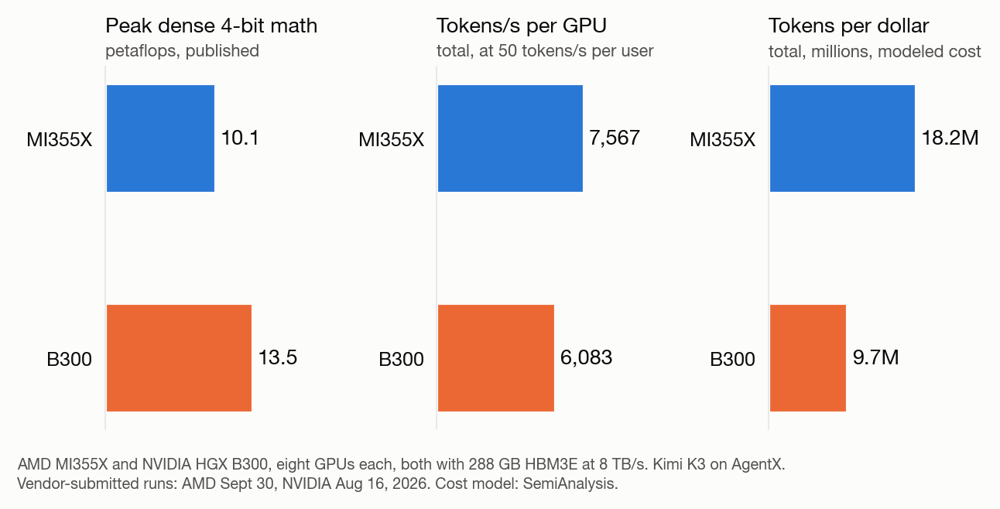

**TL;DR**

- AMD says eight of its MI355X GPUs served the open model Kimi K3 with 24% more throughput than eight NVIDIA B300s, in a public benchmark of coding-agent traffic.
- AMD leads on measured output and modeled cost per token in this benchmark. NVIDIA's B300 leads on the published peak math spec.
- The proof is strong for one model, one workload and one moment in time. Buyers should rerun the test on their own traffic before treating it as a ranking.

*The B300 has more peak math, and the MI355X served more tokens in this benchmark. Data: AMD and Embedded LLM on the vLLM blog, from SemiAnalysis InferenceX (retrieved October 9, 2026). Chart by Silicon to Serving.*

## What Happened

On October 16, AMD and its partner Embedded LLM published a post on the blog of vLLM, the popular open-source software for running AI models. It compared two servers running Kimi K3, an open model from Moonshot AI. Each server had eight GPUs: AMD's Instinct MI355X in one, NVIDIA's HGX B300 in the other.

At the same service level for each user, the AMD server produced about 7,567 tokens per second per GPU. The NVIDIA server produced about 6,083. A token is a short piece of text, often about three quarters of a word. The count includes text the model read and text it wrote, so it measures serving capacity on this workload. AMD's lead is 24%.

The same day, an NVIDIA engineer published a separate post on the same blog. It described faster Kimi K3 software for NVIDIA's GB300 GPUs, built with help from AI coding agents. It does not compare MI355X with HGX B300.

## The Positioning Story

**A narrower headline than the result.** The post's title says AMD is "Matching NVIDIA HGX B300 Throughput per GPU." The body reports a 24% lead at one service level. The headline claims less than the data shows, which makes it harder to dispute.

**A buyer's metric in place of a spec sheet.** On paper, the NVIDIA chip leads. It lists 13.5 petaflops of peak 4-bit math against 10.1 for AMD. The post does not compete on that number. It measures the output a customer pays for: tokens served per GPU at a fixed speed for each user. It then adds a cost model from the research firm SemiAnalysis, which puts AMD at about 87% more tokens per dollar.

**Evidence others can check.** The numbers come from InferenceX, a public benchmark from SemiAnalysis. The post links the AMD and NVIDIA configurations and the software changes behind the result. It also lists what differs between the two runs: dates, software versions and cache settings.

**NVIDIA's post covers a different question.** Benjamin Chislett of NVIDIA wrote about a new Kimi K3 software path for 8 or 16 GB300 GPUs. It reports faster kernels and 1.8 times better per-user speed on the same AgentX workload, measured against an earlier GB300 result. It also covers how people should review code that AI agents help write. Readers who see both posts get two separate stories: one about cost per token, one about how fast software can improve.

## The Marketing Lens

| | AMD and Embedded LLM post |
|---|---|
| **Claim** | The MI355X matches the HGX B300 on throughput per GPU for Kimi K3. The data shows 24% more. |
| **Metric chosen** | Tokens per second per GPU at 50 tokens per second per user, plus modeled tokens per dollar. Peak specs, where NVIDIA leads, are mentioned but not the basis of the claim. |
| **Proof** | Public InferenceX benchmark curves, linked configurations and named software changes. The two records come from different dates and setups. |
| **Likely audience** | Our reading: teams that buy or run AI serving capacity and compare cost per token. |
| **Competitor's same-day message** | A separate engineering post on Kimi K3 software speed for GB300 and on reviewing agent-assisted code. It does not compare against the MI355X. |
| **Caveats the post states** | The two benchmark records are dated six weeks apart. The two setups differ. Numbers are interpolated to one service level. Some cost assumptions are unpublished. |
| **Verdict** | A strong cost-per-token case for this model and workload, with its limits stated openly. It is a snapshot, and a newer software release on either side could change it. |

## What Buyers Should Check

- **Your own traffic.** The benchmark replays coding-agent sessions, which repeat a lot of context. A chatbot or batch job may behave differently.
- **Your own speed target.** The comparison is set at 50 tokens per second per user. A product that needs faster replies could see a different result.
- **The software version.** The two records are six weeks apart, and both sides keep changing their software. Test on the version you will run.
- **Your own costs.** The $1.50 and $2.26 per GPU-hour figures come from a cost model. Replace them with your own prices for hardware, power and support.

## What Marketers Can Take From It

- **Pick the metric your buyer pays for, then show its limits.** AMD led with tokens per GPU at a set user speed, and it still printed the peak specs where NVIDIA leads.
- **Make the evidence easy to audit.** Linking the configurations, software versions and benchmark data let engineers check the claim themselves.
- **Put the caveats next to the claim.** The post lists run dates, setup differences and unpublished cost assumptions, so a skeptical reader finds them in the post itself.

## Under the Hood

This section is for readers who want the technical detail behind the claim.

**What was measured.** The workload, called AgentX, replays real coding-agent sessions with synthetic text, keeping their request lengths, timing and repeated context. The service level is defined by the time between tokens: at the 90th percentile, that gap is one fiftieth of a second, or 50 tokens per second per user. It leaves out the wait for the first token.

| | AMD MI355X | NVIDIA HGX B300 |
|---|---|---|
| GPUs, and how the model is split | 8, with eight-way tensor parallelism | 8, with eight-way tensor parallelism |
| Number formats | 4-bit weights (MXFP4), 8-bit KV cache | 4-bit weights (FP4), 8-bit KV cache |
| Published dense 4-bit math peak | 10.1 petaflops | 13.5 petaflops |
| Memory | 288 GB HBM3E, 8 TB/s peak | 288 GB HBM3E, 8 TB/s peak |
| Configured host-memory cache budget | 224.875 GB per GPU | 281 GB per GPU |
| Submission date | September 30, 2026 | August 16, 2026 |
| Total tokens per second per GPU | about 7,567 | about 6,083 |

**Why less peak math can still win.** A model writes its answer one token at a time, a phase called decode. Each step reads the model's weights and its saved state for the conversation from memory. In Kimi K3, 24 layers keep a compressed history (multi-head latent attention, MLA), and 69 layers carry a fixed-size summary forward (Kimi Delta Attention). At the small batch sizes that fast replies need, these memory reads often limit decode more than math does. Both chips list the same memory. The bandwidth real code reaches, the links between GPUs, and the number of steps per token still differ, and software shapes all three.

**What AMD's software changed.** Kimi K3 is a mixture-of-experts model: a router sends each token to 16 of its 896 expert sub-networks. The AMD post lists more than a dozen changes to vLLM. Four stand out:

- **Spreading the history across GPUs.** Each GPU now holds one eighth of the MLA history. Before, every GPU held a full copy. For a 142,000-token conversation, the post estimates the history per GPU falls from 1.96 GB to 245 MB.
- **Keeping old context in CPU memory.** When a session's history no longer fits on the GPU, it can wait in the server's CPU memory and return when the session resumes.
- **Faster kernels.** Padding MLA's 12 query heads per GPU to 16 let the work use AMD's hand-tuned code. In a single-user test, time per output token fell from 43.8 to 23.6 milliseconds.
- **Speculative decoding.** A cheap draft step proposes three to seven tokens and the full model checks them in one pass. AMD turned this off in some high-load runs.

**NVIDIA's software work.** Chislett's post rewrites most of Kimi K3's decode steps as custom kernels in CuTe DSL, NVIDIA's Python language for GPU code. Coding agents helped write and tune them. In one layer, the step count fell from 23 kernels to 13, and the time from 130 to 69 microseconds. Without speculative decoding, decode ran 1.3 to 1.9 times faster, depending on batch size and GPU count. Full-model tests with long inputs found numerical errors that unit tests had missed. On AgentX with one user at a time, per-user speed improved 1.8 times, though that test used 16 GPUs against an earlier 8-GPU result. The author writes that agent-optimized code now arrives faster than people can review it.

**The cost model.** SemiAnalysis's total-cost-of-ownership model assigns $1.50 per MI355X GPU-hour and $2.26 per B300 GPU-hour. Combined with the throughput gap, that gives about 87% more tokens per modeled dollar for AMD.

## Papers Behind Kimi K3's Design

- **[DeepSeek-V2](https://arxiv.org/abs/2405.04434) (2024)** introduced multi-head latent attention (MLA), which Kimi K3 uses in 24 layers. It compresses the KV cache; DeepSeek-V2 reports a cache 93.3% smaller than DeepSeek 67B's.
- **[Kimi Linear](https://arxiv.org/abs/2510.26692) (2025)** introduced Kimi Delta Attention, which Kimi K3 uses in its other 69 layers. It reports up to 75% less KV cache at long context.

## Sources

- AMD and Embedded LLM, [Scaling Kimi K3 on AMD Instinct MI355X: Matching NVIDIA HGX B300 Throughput per GPU on AgentX](https://vllm.ai/blog/2026-10-16-kimi-k3-mi355x), vLLM blog, October 16, 2026. Data from SemiAnalysis InferenceX, retrieved October 9, 2026.
- Benjamin Chislett, [Hyper Optimizing Kimi K3 in vLLM: Moving Fast and Responsibly](https://vllm.ai/blog/2026-10-16-kimi-k3-megakernel), vLLM blog, October 16, 2026.
